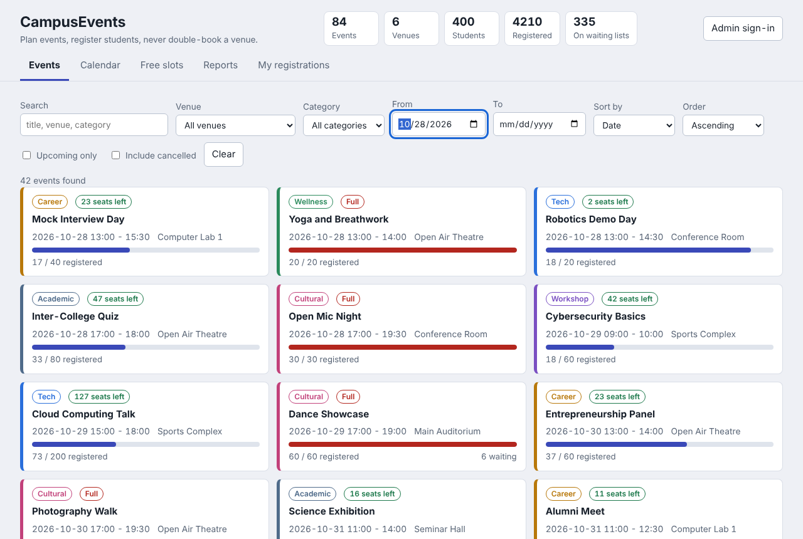
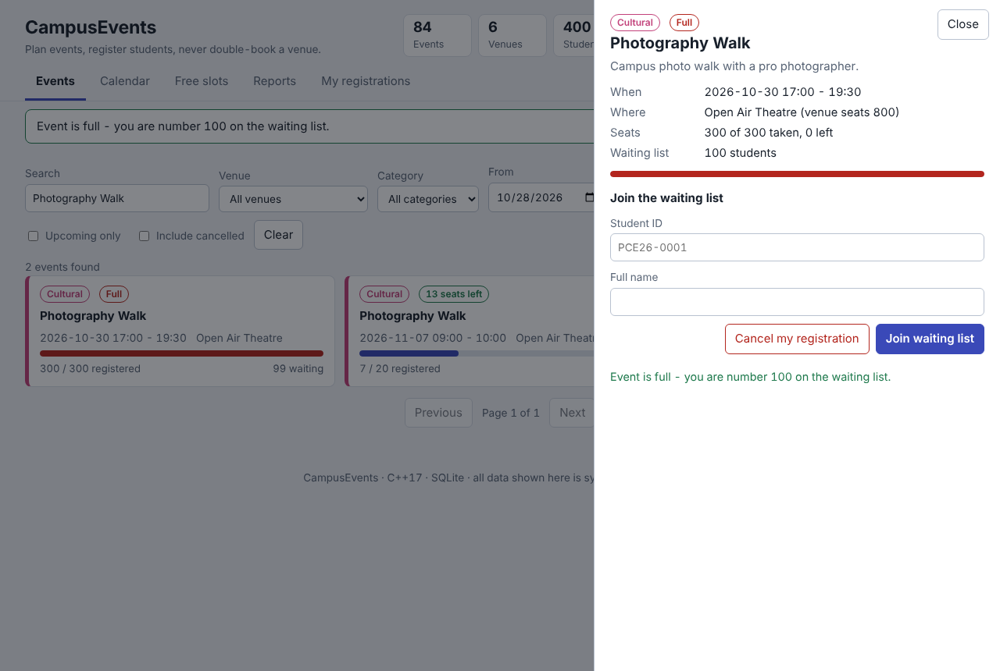
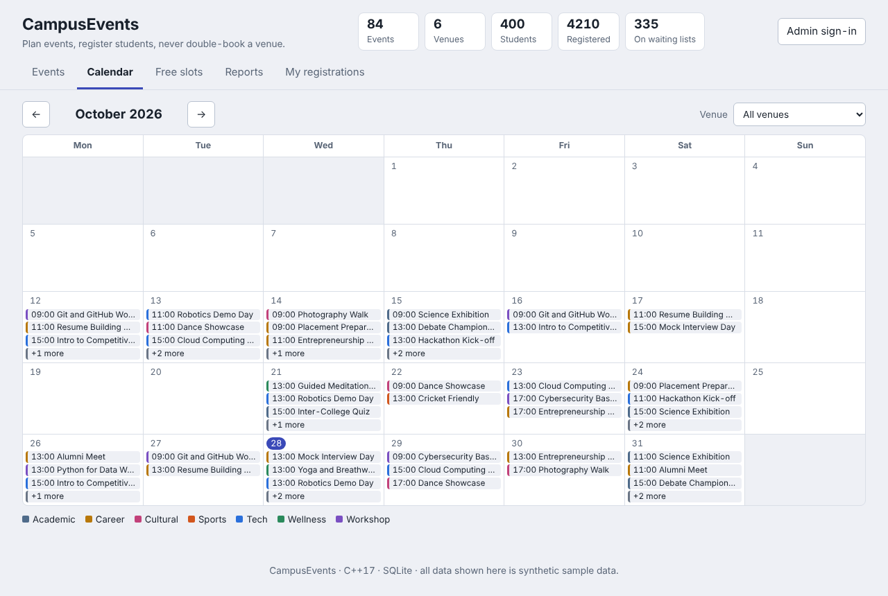
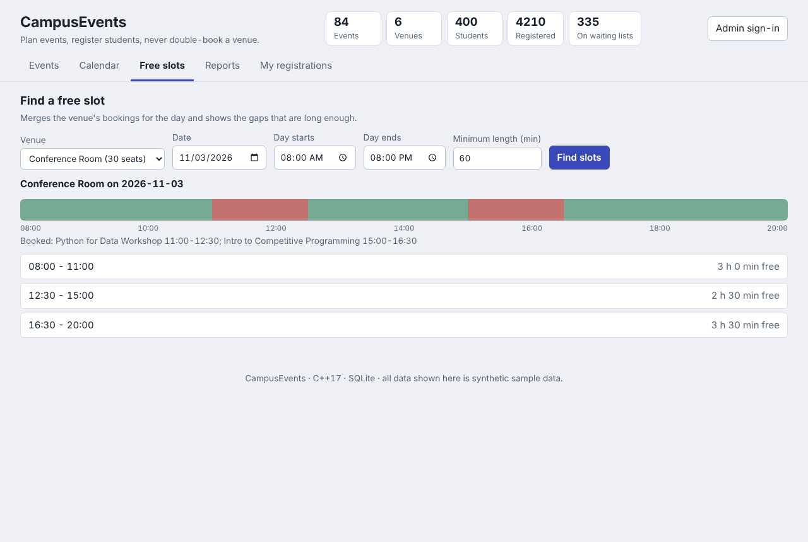
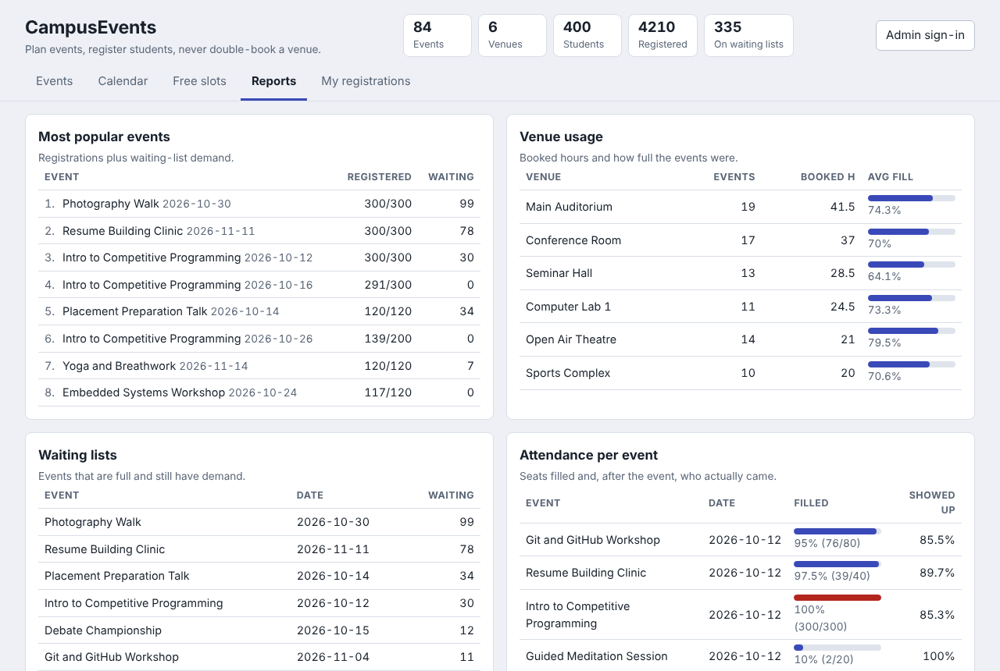
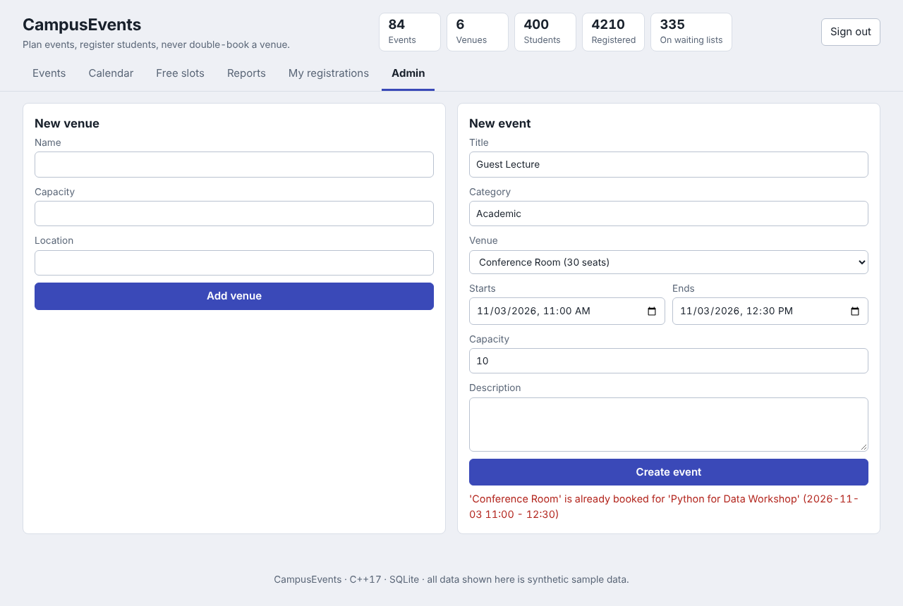
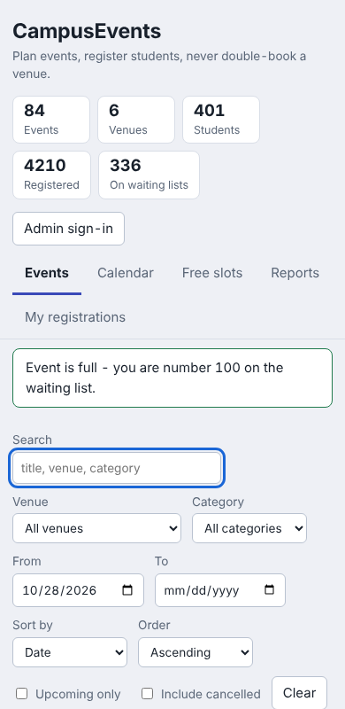

# CampusEvents

Campus event management in C++17: create events, **never double-book a venue**, register students, run a **first-come-first-served waiting list** that promotes people automatically, find free time slots, and see reports. SQLite for storage, a small embedded HTTP server for a JSON REST API, and a dependency-free web page.



| Event detail and waiting list | Calendar | Free-slot finder |
| --- | --- | --- |
|  |  |  |

| Reports | Clash refused (admin) | Phone |
| --- | --- | --- |
|  |  |  |

All people, names and numbers in the screenshots are synthetic sample data generated by `campusevents seed`.

## Quick start

```bash
./run_demo.sh            # Linux/macOS: build, load sample data, serve on http://127.0.0.1:8080
run_demo.bat             # Windows (CMake + Visual Studio or MinGW)
```

The demo admin key is `demo-admin` (click **Admin sign-in** in the page). Manual build:

```bash
cmake -S . -B build && cmake --build build -j && ctest --test-dir build --output-on-failure
```

If your system has no SQLite development package, the bundled copy in `third_party/sqlite3` is used automatically (`-DCE_FORCE_VENDORED_SQLITE=ON` forces it).

```
campusevents serve --db campusevents.db --demo     # start; --demo loads sample data into an empty database
campusevents seed  --db other.db                   # only load sample data
campusevents bench --events 20000                  # speed measurement on a throw-away database
```

Admin key: set the `CAMPUS_ADMIN_KEY` environment variable. If it is not set, a random key is generated and printed when the server starts. A live walkthrough of the main rules with `curl` is in `data/demo_walkthrough.sh`.

## What it does

| Feature | How it works |
| --- | --- |
| Create events | Title, category, venue, start/end time, capacity. Validated: 15 min to 12 h long, capacity 1–100,000, no control characters |
| **Venue clash detection** | Two events clash if `a.start < b.end AND b.start < a.end`. The refusal names the event in the way (`'Seminar Hall' is already booked for 'Python Workshop' (2026-11-03 11:00 - 12:30)`). Back-to-back events (end = start) are allowed |
| Venue capacity check | An event cannot be larger than its venue |
| Registration | Student ID + name. Free seat → confirmed. Full → joins the waiting list at the back |
| **Waiting list (FIFO)** | When a confirmed student cancels, the longest-waiting student is promoted in the same transaction. Cancelling while waiting promotes nobody |
| Student clash | A student cannot sign up for two overlapping events (waiting list counts too, so a promotion can never create a clash) |
| **Free-slot finder** | Takes a venue and a day, merges the booked intervals, and lists the gaps that are long enough |
| Search and filters | Free text (title, description, category, venue), venue, category, date range, status, sort by date / popularity / seats left / title, paging |
| Reports | Attendance per event, most popular events (registrations + waiting demand), venue usage, waiting lists. All `JOIN` + `GROUP BY` |
| Check-in and CSV | Admin can check in confirmed students and download the attendee list as CSV (spreadsheet-formula safe) |
| Web page | Event list, calendar month view, free-slot timeline, reports, "my registrations", admin forms |

## Architecture

```
 browser (web/)  ──HTTP/JSON──►  api  ──►  EventService (rules, one transaction per operation)
                                             │
                                             ▼
                                        Repository (all SQL, prepared statements)
                                             │
                                             ▼
                                   Database / Transaction (SQLite, RAII)
```

| Module | Role |
| --- | --- |
| `types` | Entity classes `Venue`, `Event`, `Registration`, and `AppError` (carries the HTTP status and a machine-readable code) |
| `util` | Interval maths (`overlaps`, `mergeIntervals`, `freeGaps`), strict date parsing, CSV escaping |
| `db` | SQLite wrapper with bound parameters, `Transaction` (rolls back unless `commit()` is called), schema |
| `repository` | Every query, including the report queries. Knows nothing about rules or HTTP |
| `service` | The business rules above. Each public method is atomic: lock, `BEGIN IMMEDIATE`, check, change, commit |
| `api` | Routes, JSON body validation, admin key check, security headers |
| `seed` | Deterministic sample-data generator that goes through the same rules as real requests |
| `web/` | Plain HTML, CSS and JavaScript. No libraries, no external files |

### Data model

```
venues(id, name UNIQUE, capacity, location)
events(id, title, category, description, venue_id → venues, start_ts, end_ts, capacity, status)
students(id, name)
registrations(id, event_id → events, student_id → students, status, checked_in, created_at, UNIQUE(event_id, student_id))
```

`registrations.id` only ever grows, so ordering waiting students by `id` *is* first-in-first-out; no separate queue table is needed.

### Rules are enforced twice

The C++ code checks every rule and gives a clear error message. SQLite triggers enforce the three most important ones again, so even a bug or a hand-written SQL statement cannot corrupt the data:

| Trigger | Blocks |
| --- | --- |
| `trg_no_venue_clash` | inserting an active event that overlaps another active event in the same venue |
| `trg_event_fits_venue` | an event larger than its venue |
| `trg_capacity_insert`, `trg_capacity_update` | more confirmed students than seats (also when promoting from the waiting list) |

Plus `CHECK` constraints, foreign keys, and a `UNIQUE (event_id, student_id)` constraint.

## REST API

JSON in, JSON out. Errors look like `{"error": "human readable text", "code": "venue_clash", "details": {...}}`. Full reference with examples: [docs/API.md](docs/API.md).

| Method and path | Who | Purpose |
| --- | --- | --- |
| `GET /api/events?q=&venue_id=&category=&from=&to=&status=&sort=&order=&limit=&offset=` | everyone | Search and filter |
| `GET /api/events/{id}` | everyone | One event with live seat counts |
| `POST /api/events` | admin | Create an event (409 on clash, 400 if too big for the venue) |
| `POST /api/events/{id}/cancel` | admin | Cancel an event (frees the slot) |
| `POST /api/events/{id}/register` | everyone | Register or join the waiting list |
| `DELETE /api/events/{id}/registrations/{studentId}` | everyone | Cancel; response says who was promoted |
| `POST /api/events/{id}/checkin` | admin | Check in a confirmed student |
| `GET /api/events/{id}/attendees`, `…/attendees.csv` | admin | Attendee list |
| `GET /api/venues`, `POST /api/venues` | everyone / admin | List or add venues |
| `GET /api/venues/{id}/free-slots?date=&day_start=&day_end=&min_minutes=` | everyone | Free slots |
| `GET /api/students/{id}/registrations` | everyone | A student's registrations and queue positions |
| `GET /api/reports/attendance`, `/popularity`, `/venues`, `/waitlist`, `GET /api/stats` | everyone | Reports |

## Security

* All SQL uses bound parameters; the sort column comes from a fixed whitelist; `LIKE` wildcards in search text are escaped.
* Every value shown in the page goes through `textContent`, never `innerHTML`. A strict Content-Security-Policy (`script-src 'self'`, no inline script or style) backs this up.
* Admin endpoints need the `X-Admin-Key` header (compared in constant time). A server with no key configured rejects all admin calls.
* `POST` requests must be `application/json`, which blocks cross-site HTML form posts.
* The server listens on `127.0.0.1` by default, limits request bodies to 64 KB, and uses a fixed worker pool.
* CSV export neutralises cells that start with `=`, `+`, `-` or `@`.

## Testing

```bash
ctest --test-dir build --output-on-failure      # or ./build/campusevents_tests [name-filter]
```

**49 automated tests (about 4,500 checks)** with a small self-written test runner:

* interval overlap edge cases (touching, contained, identical, one-minute overlap, across midnight)
* clash, capacity and student-clash rules, validation of every input
* waiting-list order, promotion, cancellation of waiting students
* free-slot finder (merging, clipping, minimum length, overnight events)
* search filters, sorting, paging, wildcard and SQL-injection text
* report numbers, including a check that venue hours are not multiplied by the number of attendees
* database triggers fired directly with hand-written SQL, and transaction rollback
* **randomised model test**: 4,000 random register/cancel operations compared with a simple in-memory model
* **concurrency tests**: 24 threads (and 20 HTTP clients) registering at once never over-book; mixed register/cancel threads never leave a seat idle while someone waits
* sample-data invariants (no overlaps, never over capacity, waiting only when full, no student in two places)
* the REST API over a real socket: status codes, admin protection, content-type checks, malformed bodies

The suite also passes under AddressSanitizer + UndefinedBehaviorSanitizer (CI job `sanitizers`), and the concurrency tests pass under ThreadSanitizer. A browser check of the web page (`tests/ui/ui_check.js`, needs Node and Playwright) clicks through registration, the waiting list, admin sign-in, clash refusal, CSV download, calendar, free slots, reports, an HTML-injection attempt and the phone layout. It is not part of CI.

## Performance

Measured with `campusevents bench` on a 2-core cloud VM (your numbers will differ), 20,000 events in 50 venues:

| Operation | Result |
| --- | --- |
| Create events with a clash check on each (plus 2,000 refused overlaps) | about 5,700 bookings/s |
| Register students (100,000 attempts, 5,000 students) | about 3,500/s |
| Free-slot lookup | about 0.05 ms |
| Text search over 20,000 events | about 11 ms (a `LIKE '%…%'` scan; the one query that does not use an index) |
| Venue usage + popularity + attendance reports over 20,000 events | about 0.3 s together |

## Limitations (what a real deployment would still need)

* **Students are identified only by the ID they type.** There are no logins, so anyone who knows an ID can cancel that student's registration. A real system would add authentication.
* The admin key is a single shared secret sent over plain HTTP. Use it on localhost, or put the server behind HTTPS.
* Times are wall-clock times with no time-zone handling (fine for a single campus).
* No editing or rescheduling of events: cancel and re-create.
* Single process, single SQLite file. Fine for a campus, not for thousands of writes per second.
* Developed and tested on Linux (GCC and Clang, sanitizers). The code is portable and CI builds on Windows and macOS, but I have not run it on those systems myself.

## Project layout

```
include/campusevents/   headers          src/   implementation          tests/   test_main.cpp, ui/ (browser checks)
web/                    index.html, style.css, app.js
docs/                   API.md, screenshots/        data/   demo_walkthrough.sh
third_party/            cpp-httplib, nlohmann/json, SQLite amalgamation (see THIRD_PARTY_NOTICES.md)
```

## License

MIT, see [LICENSE](LICENSE). Bundled libraries keep their own licenses ([THIRD_PARTY_NOTICES.md](THIRD_PARTY_NOTICES.md)).
